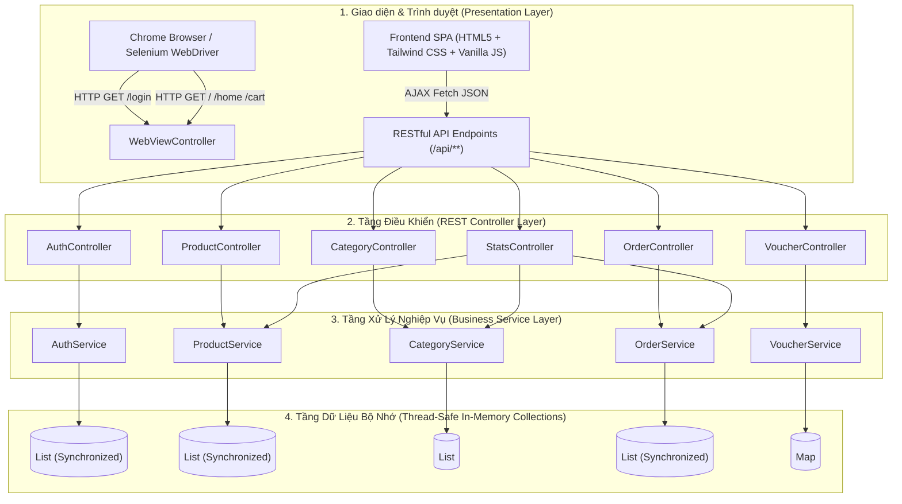
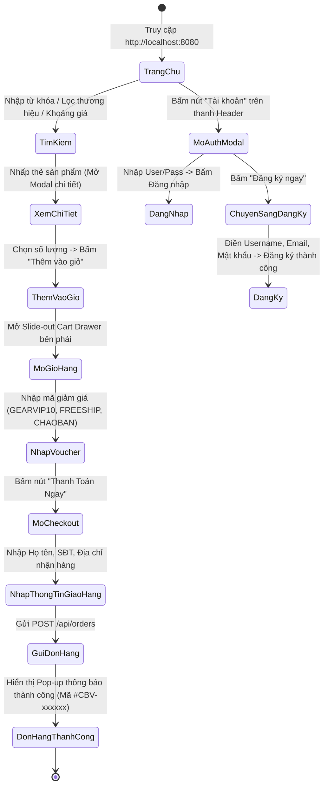

# TÀI LIỆU ĐẶC TẢ NGHIỆP VỤ HỆ THỐNG (SYSTEM SPECIFICATIONS)
> **DỰ ÁN: CONBOVUIVE GEAR - WEBSITE THƯƠNG MẠI ĐIỆN TỬ GAMING GEAR & PHẦN CỨNG PC CAO CẤP**  
> **Môn học:** SOF309 - Kiểm thử nâng cao cùng AI (Advanced Software Testing with AI)  
> **Giảng viên hướng dẫn:** ThS. Trần Quang Bình (binhtq7 - Thầy Mời Giáo)  
> **Sinh viên thực hiện:** Nguyễn Hoàng | **MSSV:** TS02492 | **Lớp:** SD21304  
> **Cơ sở đào tạo:** Trường Cao đẳng FPT Polytechnic Hà Nội  
> **Phiên bản tài liệu:** v1.0.0 (Release Chuẩn hóa Tuần 1 - Milestone Y1 & Y2)  

---

## MỤC LỤC TỔNG QUAN
1. [TỔNG QUAN DỰ ÁN VÀ KIẾN TRÚC KỸ THUẬT](#1-tổng-quan-dự-án-và-kiến-trúc-kỹ-thuật)
   - 1.1. Giới thiệu dự án
   - 1.2. Môi trường triển khai & Cấu hình Runtime
   - 1.3. Ngăn xếp công nghệ (Technology Stack)
   - 1.4. Sơ đồ kiến trúc phân tầng (Layered Architecture)
   - 1.5. Cấu trúc cây thư mục mã nguồn chuẩn hóa
2. [SITEMAP & ĐẶC TẢ ĐIỀU HƯỚNG GIAO DIỆN (UI ROUTING)](#2-sitemap--đặc-tả-điều-hướng-giao-diện-ui-routing)
   - 2.1. Bảng ánh xạ URL & Controller Routing
   - 2.2. Luồng trải nghiệm người dùng (User Flow)
3. [ĐẶC TẢ CHI TIẾT CÁC PHÂN HỆ NGHIỆP VỤ (BUSINESS SPECIFICATIONS)](#3-đặc-tả-chi-tiết-các-phân-hệ-nghiệp-vụ-business-specifications)
   - 3.1. Phân hệ 1: Xác thực & Quản lý Tài khoản (Authentication)
   - 3.2. Phân hệ 2: Quản lý Danh mục Sản phẩm (Category Module)
   - 3.3. Phân hệ 3: Quản lý & Tra cứu Sản phẩm (Product Catalog & CRUD)
   - 3.4. Phân hệ 4: Động cơ Khuyến mãi & Mã giảm giá (Voucher Engine)
   - 3.5. Phân hệ 5: Giỏ hàng & Xử lý Đơn hàng (Cart & Order System)
   - 3.6. Phân hệ 6: Thống kê Hệ thống (System Statistics)
4. [CHI TIẾT ĐẶC TẢ RESTFUL API (API SPECIFICATIONS)](#4-chi-tiết-đặc-tả-restful-api-api-specifications)
5. [ĐẶC TẢ GIAO DIỆN & ÁNH XẠ LOCATORS (CHO SELENIUM PAGE OBJECT MODEL - Y4)](#5-đặc-tả-giao-diện--ánh-xạ-locators-cho-selenium-page-object-model---y4)
   - 5.1. Trang Đăng nhập độc lập (`/login` - `login.html`)
   - 5.2. Modal Đăng nhập / Đăng ký trên Trang chủ (`index.html`)
   - 5.3. Giỏ hàng, Mã giảm giá & Đặt hàng (`index.html`)
   - 5.4. Tìm kiếm, Bộ lọc & Modal Chi tiết sản phẩm (`index.html`)
6. [MA TRẬN PHÂN TÍCH KIỂM THỬ (TEST DESIGN SPECIFICATION CHO AI RAG & JUNIT 5)](#6-ma-trận-phân-tích-kiểm-thử-test-design-specification)
   - 6.1. Bảng phân tích Phân vùng tương đương (Equivalence Partitioning)
   - 6.2. Bảng phân tích Giá trị biên (Boundary Value Analysis - BVA)
   - 6.3. Ma trận kiểm thử Ngoại lệ nghiệp vụ (Exception Testing Matrix cho `assertThrows`)
   - 6.4. Ma trận dữ liệu kiểm thử biên Form (`@ParameterizedTest` + `@CsvSource`)
7. [KẾT LUẬN & HƯỚNG DẪN BƯỚC TIẾP THEO (MILESTONE ROADMAP)](#7-kết-luận--hướng-dẫn-bước-tiếp-theo-milestone-roadmap)

---

## 1. TỔNG QUAN DỰ ÁN VÀ KIẾN TRÚC KỸ THUẬT

### 1.1. Giới thiệu dự án
**Conbovuive Gear** là hệ sinh thái Web Thương mại điện tử chuyên cung cấp thiết bị ngoại vi thể thao điện tử (Esports Gaming Gear) và linh kiện phần cứng máy tính hiệu năng cao (Chuột gaming siêu nhẹ, Bàn phím cơ Hall Effect / Rapid Trigger, Màn hình gaming 360Hz, Card đồ họa RTX cao cấp).  
Dự án được xây dựng chuẩn hóa theo mô hình ứng dụng Web Spring Boot kết hợp Frontend Single Page Application (SPA), phục vụ trực tiếp cho toàn bộ 6 tuần thực hành của học phần **SOF309: Kiểm thử nâng cao cùng AI**, bao gồm:
1. **Kiểm thử đơn vị nâng cao (Unit Test - Y3):** Kiểm thử tầng Controller & Service bằng JUnit 5 với kỹ thuật Parameterized Test (`@ParameterizedTest` + `@CsvSource`) và Exception Testing (`assertThrows`).
2. **Kiểm thử tự động giao diện (UI Automation Test - Y4):** Áp dụng mô hình chuẩn **Page Object Model (POM)** kết hợp Selenium WebDriver 4 và TestNG Framework (Phân nhóm `@Test(groups = "smoke")`, `@DataProvider`, `ITestListener` chụp ảnh lỗi tự động).
3. **Tự động hóa tích hợp liên tục (CI/CD - Y5):** Thiết lập GitHub Actions Workflow tự động build, chạy kiểm thử trình duyệt Chrome Headless trên Linux Ubuntu và trích xuất báo cáo Artifacts.
4. **Nhật ký tương tác AI (AI Prompt Logs - Y6):** Ghi chép chi tiết quy trình AI RAG sinh Test Plan, Test Cases, Code Review và tối ưu mã nguồn để đạt mức điểm A.

---

### 1.2. Môi trường triển khai & Cấu hình Runtime
* **Môi trường cục bộ (Local Development):**
  * Hệ điều hành: Windows 11 64-bit
  * Java Development Kit (JDK): OpenJDK / Oracle JDK 17 (LTS)
  * Cổng mạng ứng dụng (Port): `8080` (URL mặc định: `http://localhost:8080`)
  * Trình quản lý gói & build: Apache Maven 3.9+
* **Cấu hình Spring Boot (`src/main/resources/application.properties`):**
  ```properties
  server.port=8080
  spring.application.name=sof309-conbovuive-gear
  spring.web.resources.static-locations=classpath:/static/
  ```
* **Cấu hình chia sẻ tài nguyên (CORS) & Static Resource Mapping (`WebConfig.java`):**
  * Cho phép truy cập từ mọi nguồn (`allowedOriginPatterns("*")`).
  * Hỗ trợ đầy đủ các phương thức HTTP: `GET`, `POST`, `PUT`, `DELETE`, `OPTIONS`.
  * Hỗ trợ cookie xác thực (`allowCredentials(true)`).
  * Định tuyến toàn bộ static web assets trực tiếp từ thư mục `classpath:/static/`.

---

### 1.3. Ngăn xếp công nghệ (Technology Stack)
| Phân tầng kỹ thuật | Công nghệ sử dụng | Phiên bản | Mục đích & Trách nhiệm |
| :--- | :--- | :---: | :--- |
| **Backend Framework** | Spring Boot Web & Validation | 3.2.5 | Cung cấp hệ thống RESTful API, Validation và Router |
| **Ngôn ngữ lập trình** | Java (LTS) | 17 | Xây dựng logic Controller, Service, Models |
| **Frontend UI/UX** | HTML5, Tailwind CSS, JavaScript (ES6) | Latest | Giao diện Dark Theme hiện đại, Responsive đa màn hình |
| **Icons & Fonts** | FontAwesome 6, Google Fonts | Plus Jakarta Sans | Tối ưu hiển thị typography và hệ thống biểu tượng gaming |
| **Kiểm thử Unit Test** | JUnit Jupiter (JUnit 5) | 5.10.2 | Kiểm thử logic biên Form và bắt ngoại lệ Controller/Service |
| **Kiểm thử UI Automation** | Selenium WebDriver | 4.20.0 | Tự động hóa thao tác trình duyệt Chrome (GUI & Headless) |
| **Kiểm thử Test Suite** | TestNG Framework | 7.9.0 | Điều phối Test Suite, Groups, DataProvider, Test Listener |
| **CI/CD Pipeline** | GitHub Actions | Ubuntu Latest | Tự động chạy toàn bộ bài kiểm tra và xuất báo cáo Artifacts |

---

### 1.4. Sơ đồ kiến trúc phân tầng (Layered Architecture)



---

### 1.5. Cấu trúc cây thư mục mã nguồn chuẩn hóa
```text
SOF309_SD21304_TS02492_NguyenHoang/
├── pom.xml                                   # Cấu hình Spring Boot, JUnit 5, Selenium 4
├── testng.xml                                # Điều phối TestNG Suite, Groups & Listeners
├── .github/
│   └── workflows/
│       └── test.yml                          # CI/CD tự động chạy kiểm thử khi push/pull request
├── docs/
│   ├── HUONG_DAN_CHI_TIET_6_TUAN.md          # Cẩm nang phân bổ tiến độ 6 tuần Assignment
│   ├── SPECIFICATIONS.md                     # Tài liệu đặc tả hệ thống hiện tại
│   ├── TEST_PLAN.md                          # Kế hoạch kiểm thử tổng thể
│   ├── TEST_CASES.md                         # Bảng kịch bản kiểm thử chi tiết
│   └── ai-logs/                              # Minh chứng tương tác AI (Điểm A)
│       └── README.md
├── src/
│   ├── main/
│   │   ├── java/com/poly/sof309/
│   │   │   ├── Sof309Application.java        # Class khởi chạy Spring Boot Application
│   │   │   ├── config/
│   │   │   │   └── WebConfig.java            # Cấu hình CORS & Static Resource Locations
│   │   │   ├── controllers/                  # 7 Bộ điều khiển (Controllers)
│   │   │   │   ├── AuthController.java       # API xác thực, đăng ký, đăng nhập, hồ sơ
│   │   │   │   ├── CategoryController.java   # API danh mục sản phẩm
│   │   │   │   ├── OrderController.java      # API quản lý và đặt hàng
│   │   │   │   ├── ProductController.java    # API tra cứu, lọc, sắp xếp, CRUD sản phẩm
│   │   │   │   ├── StatsController.java      # API thống kê tổng quan hệ thống
│   │   │   │   ├── VoucherController.java    # API xác thực và tính toán mã giảm giá
│   │   │   │   └── WebViewController.java    # Router chuyển tiếp các trang SPA & Login
│   │   │   ├── models/                       # Thực thể dữ liệu (Models & Payloads)
│   │   │   │   ├── ApiResponse.java          # Wrapper phản hồi API chuẩn hóa
│   │   │   │   ├── Category.java             # Entity Danh mục
│   │   │   │   ├── Customer.java             # Entity Khách hàng đặt đơn
│   │   │   │   ├── LoginRequest.java         # DTO dữ liệu gửi lên khi đăng nhập
│   │   │   │   ├── Order.java                # Entity Đơn hàng
│   │   │   │   ├── OrderItem.java            # Entity Chi tiết món hàng trong đơn
│   │   │   │   ├── Product.java              # Entity Sản phẩm
│   │   │   │   ├── RegisterRequest.java      # DTO dữ liệu gửi lên khi đăng ký
│   │   │   │   ├── User.java                 # Entity Tài khoản người dùng
│   │   │   │   ├── Voucher.java              # Entity Mã giảm giá
│   │   │   │   ├── VoucherVerifyRequest.java # DTO gửi mã voucher cần kiểm tra
│   │   │   │   └── VoucherVerifyResponse.java# DTO phản hồi kết quả voucher
│   │   │   └── services/                     # Tầng dịch vụ xử lý nghiệp vụ (Business Rules)
│   │   │       ├── AuthService.java          # Nghiệp vụ đăng ký, đăng nhập, mã hóa
│   │   │       ├── CategoryService.java      # Quản lý 5 danh mục gaming mặc định
│   │   │       ├── OrderService.java         # Quản lý tạo mã đơn hàng, lưu đơn hàng
│   │   │       ├── ProductService.java       # Quản lý lọc, tìm kiếm, CRUD sản phẩm
│   │   │       └── VoucherService.java       # Quản lý 4 mã coupon ưu đãi
│   │   └── resources/
│   │       ├── application.properties        # Cấu hình cổng 8080 & static resources
│   │       └── static/                       # Giao diện người dùng Web SPA
│   │           ├── index.html                # Trang chủ SPA (Hero, Products, Cart, Checkout)
│   │           ├── login.html                # Trang đăng nhập riêng biệt
│   │           ├── css/tailwind.css          # CSS dựng bằng Tailwind CSS
│   │           └── js/                       # Thư viện mô-đun JavaScript
│   │               ├── app.js                # Điều phối khởi tạo chung
│   │               ├── auth.js               # Quản lý phiên đăng nhập và Modal Auth
│   │               ├── cart.js               # Quản lý giỏ hàng, áp mã giảm giá, checkout
│   │               ├── categories.js         # Tải và hiển thị danh mục
│   │               ├── products.js           # Lọc, tìm kiếm, hiển thị lưới sản phẩm
│   │               └── slider.js             # Hero carousel banner
│   └── test/java/com/poly/sof309/
│       ├── controllers/                      # Unit Test Controller với JUnit 5 (Y3)
│       │   └── SampleControllerTest.java     # Test mẫu Parameterized & Exception
│       └── ui/                               # Automation UI Test với Selenium POM (Y4)
│           ├── pages/                        # Các lớp Page Object (Quản lý Locator & Action)
│           │   └── LoginPage.java            # Page Object cho trang Login
│           └── tests/                        # Kịch bản chạy Selenium trên Chrome (Local & CI)
│               └── LoginTest.java            # Kịch bản kiểm tra chức năng Login
└── screenshots/                              # Tự động lưu ảnh chụp màn hình khi UI Test fail
```

---

## 2. SITEMAP & ĐẶC TẢ ĐIỀU HƯỚNG GIAO DIỆN (UI ROUTING)

### 2.1. Bảng ánh xạ URL & Controller Routing
| Tuyến đường URL | Loại trang | Bộ điều khiển xử lý | Mục đích & Hành vi người dùng |
| :--- | :---: | :--- | :--- |
| `http://localhost:8080/login` | Trang tĩnh độc lập | `WebViewController.loginPage()` | Trang đăng nhập toàn màn hình (dành cho người dùng truy cập trực tiếp hoặc kịch bản Selenium POM độc lập) |
| `http://localhost:8080/` | Single Page App | `WebViewController.forwardSpa()` | Trang chủ chính: Hero Banner, Flash Sale, Danh mục, Lưới sản phẩm, Về chúng tôi, Chân trang |
| `http://localhost:8080/home` | Single Page App | `WebViewController.forwardSpa()` | Chuyển tiếp đồng nhất về trang chủ SPA |
| `http://localhost:8080/products` | Single Page App | `WebViewController.forwardSpa()` | Cuộn trực tiếp tới khu vực danh mục và bộ lọc sản phẩm |
| `http://localhost:8080/cart` | Single Page App | `WebViewController.forwardSpa()` | Mở khay trượt giỏ hàng (`#cartDrawer`) bên phải màn hình |
| `http://localhost:8080/checkout` | Single Page App | `WebViewController.forwardSpa()` | Mở Modal điền thông tin người nhận và đặt hàng |
| `http://localhost:8080/register` | Single Page App | `WebViewController.forwardSpa()` | Mở Modal đăng ký thành viên mới |

---

### 2.2. Luồng trải nghiệm người dùng (User Flow)



---

## 3. ĐẶC TẢ CHI TIẾT CÁC PHÂN HỆ NGHIỆP VỤ (BUSINESS SPECIFICATIONS)

---

### 3.1. PHÂN HỆ 1: XÁC THỰC & QUẢN LÝ TÀI KHOẢN (AUTHENTICATION)
Hệ thống hỗ trợ 2 cơ chế đăng nhập:
1. Giao diện trang chuyên biệt độc lập tại đường dẫn `/login` (`login.html`).
2. Giao diện Modal Pop-up tương tác trực tiếp trên Trang chủ (`#authModalOverlay`).

#### A. Cấu trúc thực thể người dùng (`User.java`)
* `id` (`String`): Mã định danh duy nhất (VD: `usr-01`, `usr-02`).
* `username` (`String`): Tên đăng nhập duy nhất trong hệ thống (Không phân biệt chữ hoa/thường).
* `email` (`String`): Thư điện tử của người dùng theo quy chuẩn quốc tế.
* `password` (`String`): Mật khẩu đăng nhập.
* `fullName` (`String`): Họ tên đầy đủ hiển thị trên giao diện.
* `role` (`String`): Vai trò người dùng (`ADMIN` - Quản trị viên, `USER` - Khách hàng).

#### B. Danh sách tài khoản mẫu mặc định sẵn có trong hệ thống
| Mã ID | Tên đăng nhập (`username`) | Mật khẩu (`password`) | Email tài khoản | Vai trò (`role`) | Ghi chú mục đích |
| :---: | :---: | :---: | :--- | :---: | :--- |
| `usr-01` | **`admin`** | **`123`** | `admin@conbovuive.vn` | `ADMIN` | Tài khoản Quản trị viên cửa hàng |
| `usr-02` | **`hoangnguyen`** | **`12345678@A`** | `hoang.ts02492@poly.edu.vn` | `USER` | Tài khoản sinh viên thực hiện Assignment |
| `usr-03` | **`customer`** | **`Password@123`** | `customer@gmail.com` | `USER` | Tài khoản khách hàng thông thường để kiểm thử |

#### C. Quy tắc nghiệp vụ Đăng nhập (`POST /api/auth/login`)
* **Dữ liệu gửi lên (`LoginRequest`):** `{ "username": "...", "password": "..." }`.
* **Quy tắc kiểm tra nghiệp vụ:**
  1. Kiểm tra rỗng: Nếu `request == null` hoặc `username == null` hoặc `password == null`:  
     $\rightarrow$ Trả về mã lỗi **HTTP 400 Bad Request** kèm thông điệp: `"Vui lòng nhập tài khoản và mật khẩu"`.
  2. Xác thực thông tin qua `AuthService.authenticate(username, password)`:  
     - Tên đăng nhập so khớp không phân biệt hoa/thường (`equalsIgnoreCase`).  
     - Mật khẩu so khớp chính xác từng ký tự (`equals`).
  3. Nếu sai tài khoản hoặc sai mật khẩu:  
     $\rightarrow$ Trả về mã lỗi **HTTP 401 Unauthorized** kèm thông điệp: `"Tài khoản hoặc mật khẩu không chính xác"`.
  4. Nếu thông tin đăng nhập chính xác:  
     $\rightarrow$ Trả về mã **HTTP 200 OK** kèm gói dữ liệu: thông tin tài khoản `user` và chuỗi token định danh `token: "bearer-token-cbv-" + System.currentTimeMillis()`.  
     Frontend tự động lưu vào `localStorage.setItem('cbv_user', ...)` và hiển thị tên người dùng trên Header.

#### D. Quy tắc nghiệp vụ Đăng ký (`POST /api/auth/register`)
* **Dữ liệu gửi lên (`RegisterRequest`):** `{ "username": "...", "email": "...", "password": "...", "confirmPassword": "...", "fullName": "..." }`.
* **Bảng ràng buộc dữ liệu đầu vào (Validation Rules):**
  | Trường kiểm tra | Điều kiện ràng buộc bắt buộc | Loại Exception ném ra | Mã HTTP trả về | Thông báo lỗi chi tiết |
  | :--- | :--- | :--- | :---: | :--- |
  | **Dữ liệu Request** | `request == null` | `IllegalArgumentException` | `400 Bad Request` | `"Dữ liệu đăng ký không được để trống"` |
  | **`username`** | Độ dài chuỗi bắt buộc từ 3 đến 20 ký tự | `IllegalArgumentException` | `400 Bad Request` | `"Tên đăng nhập phải từ 3 đến 20 ký tự"` |
  | **`username`** | Tính duy nhất (Chưa có tài khoản nào trùng tên) | `IllegalStateException` | `409 Conflict` | `"Tên tài khoản '{username}' đã được sử dụng"` |
  | **`email`** | Đúng định dạng regex: `^[A-Za-z0-9+_.-]+@(.+)$` | `IllegalArgumentException` | `400 Bad Request` | `"Email không đúng định dạng hợp lệ"` |
  | **`password`** | Độ dài tối thiểu từ 3 ký tự trở lên | `IllegalArgumentException` | `400 Bad Request` | `"Mật khẩu không được để trống hoặc quá ngắn"` |
  | **`confirmPassword`**| Phải trùng khớp 100% với `password` | `IllegalArgumentException` | `400 Bad Request` | `"Xác nhận mật khẩu không trùng khớp"` |
* **Xử lý đăng ký thành công:**  
  Tự động sinh mã ID `usr-{danh_sach.size() + 1}`, gán vai trò mặc định `role = "USER"`. Trả về mã **HTTP 201 Created** kèm thông điệp: `"Đăng ký tài khoản thành công"`.

---

### 3.2. PHÂN HỆ 2: QUẢN LÝ DANH MỤC SẢN PHẨM (CATEGORY MODULE)
Hệ thống định nghĩa 5 danh mục sản phẩm cốt lõi (`Category.java`):

| Mã danh mục (`id`) | Tên danh mục (`name`) | Mô tả đặc tính nổi bật | Thương hiệu đối tác (`popularBrands`) |
| :---: | :--- | :--- | :--- |
| **`mouse`** | Chuột Gaming | Cảm biến quang học cao cấp, trọng lượng siêu nhẹ dưới 60g | Logitech, Razer, ATK, Mchose |
| **`keyboard`** | Bàn Phím Cơ | Switch từ tính Rapid Trigger & nhôm CNC nguyên khối | Wooting, ATK, Mchose, Razer |
| **`monitor`** | Màn Hình Gaming | Tần số quét 165Hz - 360Hz & tấm nền OLED siêu thực | Zowie, AOC, Asus, Samsung |
| **`gpu`** | Card Đồ Họa (GPU) | Kiến trúc tối tân phục vụ Gaming 4K đỉnh cao & AI Workloads | Asus, Colorful, MSI, Zotac |
| **`audio`** | Tai Nghe Gaming | Âm thanh vòm không gian, định vị tiếng bước chân chuẩn xác | HyperX, SteelSeries, Logitech, Razer |

* **API Endpoints:**
  * `GET /api/categories`: Lấy danh sách 5 danh mục cùng ảnh đại diện và thương hiệu tương ứng.

---

### 3.3. PHÂN HỆ 3: QUẢN LÝ & TRA CỨU SẢN PHẨM (PRODUCT CATALOG & CRUD)

#### A. Cấu trúc thực thể sản phẩm (`Product.java`)
* `id` (`String`): Mã sản phẩm (Định dạng: `cbv-01`, `cbv-02`,...).
* `name` (`String`): Tên thương phẩm của thiết bị.
* `category` (`String`): Mã nhóm danh mục (`mouse`, `keyboard`, `monitor`, `gpu`, `audio`).
* `categoryName` (`String`): Tên tiếng Việt hiển thị của nhóm danh mục.
* `brand` (`String`): Thương hiệu sản xuất (VD: `Logitech`, `Razer`, `Wooting`,...).
* `price` (`long`): Giá bán thực tế (VNĐ). Yêu cầu bắt buộc $> 0$.
* `oldPrice` (`long`): Giá niêm yết ban đầu trước khuyến mãi.
* `discount` (`String`): Tỷ lệ chiết khấu hiển thị (VD: `"-10%"`).
* `badge` (`String`): Nhãn đặc quyền (VD: `"HOT SELLER"`, `"TOP 1 VALORANT"`, `"BEST VALUE"`).
* `image` (`String`): Đường dẫn URL ảnh đại diện.
* `gallery` (`List<String>`): Danh sách ảnh chi tiết nhiều góc độ.
* `description` (`String`): Đoạn văn bản mô tả tính năng nổi bật.
* `specs` (`Map<String, String>`): Bảng thông số kỹ thuật (Cảm biến, Trọng lượng, Tần số quét,...).
* `inStock` (`boolean`): Trạng thái còn hàng hay hết hàng.
* `stockCount` (`int`): Số lượng hàng tồn kho. Yêu cầu bắt buộc $\ge 0$.
* `rating` (`double`): Điểm đánh giá chất lượng (Thang điểm từ 1.0 đến 5.0).
* `reviewsCount` (`int`): Tổng số lượng người dùng đã gửi đánh giá.

#### B. Cơ sở dữ liệu mẫu ban đầu (16 sản phẩm Gaming Gear đỉnh cao)
1. `cbv-01`: **Logitech G Pro X Superlight 2** (Chuột Gaming - Giá: 3.490.000₫ - Kho: 18 cái)
2. `cbv-02`: **Razer Viper V3 Pro Wireless** (Chuột Gaming - Giá: 3.990.000₫ - Kho: 25 cái)
3. `cbv-03`: **ATK Blazing Sky F1 Ultimate** (Chuột Gaming - Giá: 1.890.000₫ - Kho: 30 cái)
4. `cbv-04`: **Mchose A5 Pro Max Wireless** (Chuột Gaming - Giá: 1.090.000₫ - Kho: 42 cái)
5. `cbv-05`: **Wooting 60HE+ Rapid Trigger** (Bàn Phím Cơ - Giá: 4.890.000₫ - Kho: 12 cái)
6. `cbv-06`: **ATK RS7 Pro Hall Effect CNC** (Bàn Phím Cơ - Giá: 2.490.000₫ - Kho: 15 cái)
7. `cbv-07`: **Mchose GX87 Nhôm CNC 3 Modes** (Bàn Phím Cơ - Giá: 1.690.000₫ - Kho: 20 cái)
8. `cbv-08`: **Razer Huntsman V3 Pro TKL** (Bàn Phím Cơ - Giá: 5.190.000₫ - Kho: 8 cái)
9. `cbv-09`: **BenQ Zowie XL2566K 360Hz DyAc+** (Màn Hình Gaming - Giá: 16.900.000₫ - Kho: 6 cái)
10. `cbv-10`: **AOC 24G2SP 165Hz IPS 1ms** (Màn Hình Gaming - Giá: 3.290.000₫ - Kho: 14 cái)
11. `cbv-11`: **Asus ROG Swift PG27AQDM OLED 240Hz** (Màn Hình Gaming - Giá: 23.900.000₫ - Kho: 5 cái)
12. `cbv-12`: **Samsung Odyssey Neo G9 49 inch** (Màn Hình Gaming - Giá: 32.900.000₫ - Kho: 3 cái)
13. `cbv-13`: **Asus ROG Strix GeForce RTX 5090 OC** (Card Đồ Họa - Giá: 62.900.000₫ - Kho: 2 cái)
14. `cbv-14`: **Colorful iGame RTX 4070 Ti Super Ultra W** (Card Đồ Họa - Giá: 24.500.000₫ - Kho: 7 cái)
15. `cbv-15`: **MSI GeForce RTX 4060 Gaming X 8G** (Card Đồ Họa - Giá: 8.990.000₫ - Kho: 16 cái)
16. `cbv-16`: **Zotac Gaming RTX 4060 Twin Edge OC** (Card Đồ Họa - Giá: 7.690.000₫ - Kho: 11 cái)

#### C. Quy tắc lọc, tra cứu và sắp xếp (`GET /api/products`)
Hỗ trợ các tham số truy vấn (Query Parameters):
* `category`: Lọc theo mã danh mục (`mouse`, `keyboard`,...).
* `brand`: Lọc theo tên thương hiệu (`Logitech`, `Razer`, `Wooting`,...).
* `search`: Tìm kiếm tương đối không phân biệt chữ hoa/thường trên cả 4 trường: `name`, `brand`, `categoryName`, `description`.
* `minPrice` & `maxPrice`: Lọc sản phẩm trong khoảng giá mong muốn ($minPrice \le price \le maxPrice$).
* `sort`:
  * `price-asc`: Giá tăng dần từ thấp đến cao.
  * `price-desc`: Giá giảm dần từ cao xuống thấp.
  * `rating`: Sắp xếp theo điểm đánh giá chất lượng cao nhất lên đầu.
  * `reviews`: Sắp xếp theo số lượng đánh giá nhiều nhất lên đầu.

#### D. Quy tắc CRUD sản phẩm
* **Thêm mới sản phẩm (`POST /api/products`):**
  * Ràng buộc:
    * `product == null` $\rightarrow$ Ném `IllegalArgumentException("Dữ liệu sản phẩm không được rỗng")`.
    * `name == null || name.trim().isEmpty()` $\rightarrow$ Ném `IllegalArgumentException("Tên sản phẩm không được để trống")`.
    * `price <= 0` $\rightarrow$ Ném `IllegalArgumentException("Giá bán sản phẩm phải lớn hơn 0")`.
    * `stockCount < 0` $\rightarrow$ Ném `IllegalArgumentException("Số lượng tồn kho không được âm")`.
    * Tên trùng lặp $\rightarrow$ Ném `IllegalStateException("Sản phẩm với tên '{name}' đã tồn tại")`.
    * Tự sinh ID dạng `cbv-{size + 1}` nếu client không truyền `id`.
  * Trả về **HTTP 201 Created** khi thành công; **HTTP 400 Bad Request** khi vi phạm ràng buộc.
* **Cập nhật sản phẩm (`PUT /api/products/{id}`):**
  * Không tìm thấy sản phẩm với `id` $\rightarrow$ Ném `NoSuchElementException("Không tìm thấy sản phẩm có mã: {id}")` (Trả về HTTP 400).
  * Hỗ trợ cập nhật từng phần: Chỉ cập nhật các giá trị hợp lệ được truyền lên (`name`, `price > 0`, `category`, `brand`, `stockCount >= 0`).
  * Trả về **HTTP 200 OK** khi hoàn tất.
* **Xóa sản phẩm (`DELETE /api/products/{id}`):**
  * Xóa thành công khỏi danh sách $\rightarrow$ Trả về **HTTP 200 OK**.
  * Không tìm thấy mã sản phẩm $\rightarrow$ Trả về **HTTP 404 Not Found** (`"Không tìm thấy sản phẩm để xóa"`).

---

### 3.4. PHÂN HỆ 4: ĐỘNG CƠ KHUYẾN MÃI & MÃ GIẢM GIÁ (VOUCHER ENGINE)

#### A. Cấu trúc thực thể mã giảm giá (`Voucher.java`)
* `code` (`String`): Mã ưu đãi viết hoa (VD: `GEARVIP10`).
* `discountPercent` (`int`): Tỷ lệ chiết khấu theo % (0% - 100%).
* `discountAmount` (`long`): Số tiền giảm trừ cố định trực tiếp (VNĐ).
* `freeShipping` (`boolean`): Cờ miễn phí hoàn toàn cước vận chuyển.
* `description` (`String`): Mô tả điều kiện ưu đãi.

#### B. Danh mục các mã giảm giá có hiệu lực trong hệ thống
| Mã Voucher (`code`) | Tỷ lệ giảm (`discountPercent`) | Số tiền giảm (`discountAmount`) | Miễn phí ship (`freeShipping`) | Quyền lợi áp dụng |
| :---: | :---: | :---: | :---: | :--- |
| **`GEARVIP10`** | **10%** | 0₫ | `false` | Giảm trực tiếp 10% trên tổng giá trị tiền hàng |
| **`FREESHIP`** | 0% | 0₫ | **`true`** | Miễn phí 100% cước phí giao hàng toàn quốc |
| **`CHAOBAN`** | 0% | **100.000₫** | `false` | Giảm ngay 100.000₫ tiền mặt cho khách hàng mới |
| **`CONBOVUIVE`** | **15%** | 0₫ | `false` | Đặc quyền thành viên Conbovuive - Giảm 15% tổng đơn |

#### C. Quy tắc kiểm tra mã voucher (`POST /api/voucher/verify`)
* **Dữ liệu gửi lên (`VoucherVerifyRequest`):** `{ "code": "..." }`.
* **Quy tắc xử lý:**
  1. Kiểm tra rỗng: Nếu `code == null` hoặc `code.trim().isEmpty()`:  
     $\rightarrow$ Trả về **HTTP 400 Bad Request** kèm thông báo `"Vui lòng nhập mã giảm giá"`.
  2. Chuẩn hóa chuỗi: Chuyển toàn bộ thành chữ in hoa và cắt khoảng trắng thừa (`cleanCode = code.toUpperCase().trim()`).
  3. Nếu mã tồn tại:  
     $\rightarrow$ Trả về **HTTP 200 OK** (`VoucherVerifyResponse` có `isValid: true`, tỷ lệ %, số tiền giảm và cờ free shipping).
  4. Nếu mã không tồn tại hoặc sai chính tả:  
     $\rightarrow$ Trả về **HTTP 404 Not Found** (`VoucherVerifyResponse` có `isValid: false`, thông điệp: `"Mã giảm giá không hợp lệ hoặc đã hết hạn!"`).

---

### 3.5. PHÂN HỆ 5: GIỎ HÀNG & XỬ LÝ ĐƠN HÀNG (CART & ORDER SYSTEM)

#### A. Logic giỏ hàng phía Client (`cart.js`)
* Giỏ hàng được lưu trữ bền vững tại `localStorage.getItem('cbv_cart')`.
* Mỗi phần tử giỏ hàng gồm: `id`, `name`, `price`, `image`, `quantity`.
* Tự động đồng bộ số lượng badge `#cartCount` trên thanh Header.
* Chính sách phí vận chuyển:
  * Phí giao hàng tiêu chuẩn mặc định: `30.000₫`.
  * Nếu tổng tiền hàng $\ge 2.000.000₫$ hoặc mã voucher kích hoạt quyền lợi `freeShipping`:  
    $\rightarrow$ Phí vận chuyển tự động tính bằng `0₫` (Miễn phí vận chuyển).

#### B. Cấu trúc thực thể đơn đặt hàng (`Order.java` & `Customer.java`)
* `id` (`String`): Mã đơn hàng định dạng `CBV-xxxxxx` (với xxxxxx là 6 chữ số ngẫu nhiên từ 100000 đến 999999).
* `createdAt` (`String`): Dấu thời gian tạo đơn theo chuẩn ISO 8601 (VD: `2026-11-11T16:20:00`).
* `status` (`String`): Trạng thái đơn hàng (Khởi tạo mặc định: `"Chờ xác nhận"`).
* `customer` (`Customer`):
  * `name` (`String`): Họ tên người nhận hàng (Bắt buộc).
  * `phone` (`String`): Số điện thoại liên lạc giao hàng (Bắt buộc).
  * `email` (`String`): Email nhận thông báo hóa đơn điện tử (Tùy chọn).
  * `address` (`String`): Địa chỉ nhận hàng chi tiết (Bắt buộc).
  * `note` (`String`): Ghi chú giao hàng đặc biệt.
* `items` (`List<OrderItem>`): Danh sách sản phẩm đặt mua kèm số lượng và đơn giá.
* `subtotal` (`long`): Tổng tiền sản phẩm trước khi áp dụng chiết khấu.
* `shippingFee` (`long`): Cước phí giao hàng (0₫ hoặc 30.000₫).
* `discountAmount` (`long`): Số tiền được miễn giảm từ voucher.
* `voucherCode` (`String`): Mã ưu đãi đã sử dụng (nếu có).
* `total` (`long`): Tổng số tiền thanh toán cuối cùng của đơn hàng.

#### C. Quy tắc nghiệp vụ Tạo đơn hàng (`POST /api/orders`)
* **Ràng buộc kiểm tra tính hợp lệ dữ liệu:**
  * Bắt buộc phải có đối tượng `customer`.
  * `customer.name`: Không được để trống.
  * `customer.phone`: Không được để trống.
  * `customer.address`: Không được để trống.
  * `items`: Bắt buộc phải có ít nhất 1 sản phẩm ($items.size() > 0$).
* **Xử lý vi phạm:**  
  $\rightarrow$ Trả về **HTTP 400 Bad Request** kèm thông báo lỗi:  
  `{"error": "Vui lòng điền đầy đủ thông tin giao hàng và giỏ hàng"}`.
* **Xử lý đặt hàng thành công:**  
  1. Tự động sinh mã đơn hàng chuẩn: `"CBV-" + (100000 + random.nextInt(900000))`.
  2. Tự động gắn dấu thời gian hiện tại và gán trạng thái `"Chờ xác nhận"`.
  3. Thêm đơn hàng mới vào đầu danh sách lưu trữ: `orders.add(0, order)`.
  4. Trả về **HTTP 201 Created** kèm dữ liệu chi tiết của đơn hàng vừa tạo.

---

### 3.6. PHÂN HỆ 6: THỐNG KÊ HỆ THỐNG (SYSTEM STATISTICS)
Cung cấp số liệu tổng quan thời gian thực phục vụ Dashboard quản trị (`StatsController.java`):
* Endpoint: `GET /api/stats`.
* Phản hồi (HTTP 200 OK):
  * `totalProducts`: Tổng số sản phẩm hiện có trong kho (Mặc định: 16).
  * `totalCategories`: Tổng số nhóm danh mục phân loại (Mặc định: 5).
  * `totalOrders`: Tổng số đơn hàng khách hàng đã tạo thành công.
  * `hotCount`: Tổng số sản phẩm có nhãn `"HOT"` hoặc `"HOT SELLER"`.

---

## 4. CHI TIẾT ĐẶC TẢ RESTFUL API (API SPECIFICATIONS)

| Phương thức | Đường dẫn Endpoint | Mô tả nghiệp vụ | Định dạng Body gửi lên | Mã HTTP thành công | Mã HTTP lỗi |
| :---: | :--- | :--- | :--- | :---: | :---: |
| `POST` | `/api/auth/login` | Xác thực đăng nhập người dùng | `{ username, password }` | `200 OK` | `400 Bad Request`<br>`401 Unauthorized` |
| `POST` | `/api/auth/register` | Đăng ký tài khoản thành viên mới | `{ username, email, password, confirmPassword, fullName }` | `201 Created` | `400 Bad Request`<br>`409 Conflict` |
| `GET` | `/api/auth/profile` | Xem thông tin hồ sơ tài khoản | Query: `?username=...` | `200 OK` | `404 Not Found` |
| `GET` | `/api/categories` | Lấy danh sách 5 nhóm danh mục | Không có body | `200 OK` | - |
| `GET` | `/api/products` | Tra cứu, lọc, sắp xếp sản phẩm | Query: `category, brand, search, sort, minPrice, maxPrice` | `200 OK` | - |
| `GET` | `/api/products/{id}`| Xem chi tiết 1 sản phẩm | Path Variable `{id}` | `200 OK` | `404 Not Found` |
| `POST` | `/api/products` | Thêm mới 1 sản phẩm vào kho | `Product` JSON Object | `201 Created` | `400 Bad Request` |
| `PUT` | `/api/products/{id}`| Cập nhật thông số sản phẩm | `Product` JSON Object | `200 OK` | `400 Bad Request` |
| `DELETE`| `/api/products/{id}`| Xóa sản phẩm khỏi danh mục | Path Variable `{id}` | `200 OK` | `404 Not Found` |
| `POST` | `/api/voucher/verify` | Kiểm tra tính hợp lệ của voucher | `{ code }` | `200 OK` | `400 Bad Request`<br>`404 Not Found` |
| `GET` | `/api/orders` | Lấy danh sách lịch sử đơn hàng | Không có body | `200 OK` | - |
| `GET` | `/api/orders/{id}` | Xem chi tiết tiến độ đơn hàng | Path Variable `{id}` | `200 OK` | `404 Not Found` |
| `POST` | `/api/orders` | Khởi tạo đơn đặt hàng mới | `Order` JSON Object (gồm Customer và Items) | `201 Created` | `400 Bad Request` |
| `GET` | `/api/stats` | Lấy các số liệu thống kê hệ thống | Không có body | `200 OK` | - |

---

## 5. ĐẶC TẢ GIAO DIỆN & ÁNH XẠ LOCATORS (CHO SELENIUM PAGE OBJECT MODEL - Y4)

Tài liệu này cung cấp định danh chính xác (ID, XPath, CSS Selector) của toàn bộ phần tử giao diện phục vụ viết các lớp Page Object (`LoginPage`, `HomePage`, `ProductDetailPage`, `CartDrawer`, `CheckoutPage`):

### 5.1. Trang Đăng nhập độc lập (`/login` - `login.html`)
| Tên phần tử giao diện | Thẻ HTML | Định danh Locator (By ID / XPath) | Vai trò trong kiểm thử tự động |
| :--- | :---: | :--- | :--- |
| **Ô nhập tên tài khoản** | `<input>` | `By.id("username")` | Nhập username hoặc email |
| **Ô nhập mật khẩu** | `<input>` | `By.id("password")` | Nhập mật khẩu |
| **Nút bấm Đăng Nhập** | `<button>` | `By.xpath("//button[@type='submit']")` | Kích hoạt sự kiện submit đăng nhập |
| **Khung thông báo lỗi** | `<div>` | `By.id("error-message")` | Kiểm tra thông điệp báo lỗi khi đăng nhập thất bại |
| **Liên kết về Trang chủ**| `<a>` | `By.xpath("//a[contains(@href, '/')]")` | Điều hướng quay trở về trang chủ |

---

### 5.2. Modal Đăng nhập / Đăng ký trên Trang chủ (`index.html`)
| Tên phần tử giao diện | Thẻ HTML | Định danh Locator | Vai trò trong kiểm thử tự động |
| :--- | :---: | :--- | :--- |
| **Lớp phủ Modal Auth** | `<div>` | `By.id("authModalOverlay")` | Kiểm tra trạng thái đóng/mở của cửa sổ Auth |
| **Nút mở Tài khoản** | `<button>`| `By.id("accountBtn")` | Bấm để mở form đăng nhập từ thanh Header |
| **Nhãn hiển thị tên User**| `<span>` | `By.id("accountLabel")` | Kiểm tra tên người dùng hiển thị sau khi đăng nhập |
| **Menu người dùng** | `<div>` | `By.id("userDropdown")` | Menu dropdown chứa nút Xem đơn hàng và Đăng xuất |
| **Nút Đăng xuất** | `<button>`| `By.id("logoutBtn")` | Xóa phiên đăng nhập và trở về trạng thái Guest |
| **Ô tài khoản Modal** | `<input>` | `By.id("loginEmail")` | Nhập tài khoản/email tại Modal |
| **Ô mật khẩu Modal** | `<input>` | `By.id("loginPassword")` | Nhập mật khẩu tại Modal |
| **Nút chuyển sang Đăng ký**| `<a>` | `By.id("switchToRegister")` | Chuyển đổi khung hiển thị sang Đăng ký |
| **Ô họ tên đăng ký** | `<input>` | `By.id("regName")` | Nhập họ tên đầy đủ thành viên mới |
| **Ô email đăng ký** | `<input>` | `By.id("regEmail")` | Nhập địa chỉ email đăng ký |
| **Ô SĐT đăng ký** | `<input>` | `By.id("regPhone")` | Nhập số điện thoại đăng ký |
| **Ô mật khẩu đăng ký** | `<input>` | `By.id("regPassword")` | Nhập mật khẩu khởi tạo |
| **Nút submit Đăng ký** | `<button>`| `By.xpath("//form[@id='registerForm']//button[@type='submit']")` | Gửi form đăng ký tài khoản |

---

### 5.3. Giỏ hàng, Mã giảm giá & Đặt hàng (`index.html`)
| Tên phần tử giao diện | Thẻ HTML | Định danh Locator | Vai trò trong kiểm thử tự động |
| :--- | :---: | :--- | :--- |
| **Nút mở Giỏ hàng** | `<button>`| `By.id("cartToggleBtn")` | Kích hoạt mở khay trượt giỏ hàng |
| **Badge đếm số lượng giỏ**| `<span>` | `By.id("cartCount")` | Kiểm tra số lượng món hàng hiển thị trên Header |
| **Khay trượt Giỏ hàng** | `<div>` | `By.id("cartDrawer")` | Khay hiển thị chi tiết giỏ hàng bên phải |
| **Nút đóng Giỏ hàng** | `<button>`| `By.id("closeCartBtn")` | Đóng khay trượt giỏ hàng |
| **Danh sách sản phẩm giỏ**| `<div>` | `By.id("cartItemsContainer")` | Danh sách các thẻ item sản phẩm trong giỏ |
| **Ô nhập mã giảm giá** | `<input>` | `By.id("voucherInput")` | Nhập mã coupon ưu đãi (VD: `GEARVIP10`) |
| **Nút Áp dụng voucher** | `<button>`| `By.id("applyVoucherBtn")` | Kích hoạt xác thực mã giảm giá |
| **Thông báo kết quả voucher**| `<div>` | `By.id("voucherMsg")` | Kiểm tra câu thông báo hợp lệ / không hợp lệ |
| **Tiền tạm tính** | `<span>` | `By.id("cartSubtotal")` | Kiểm tra tổng giá trị tiền hàng trước ưu đãi |
| **Cước phí giao hàng** | `<span>` | `By.id("cartShipping")` | Kiểm tra phí vận chuyển (30.000₫ hoặc Miễn phí) |
| **Số tiền được giảm** | `<div>` | `By.id("voucherDiscountRow")` | Kiểm tra số tiền được khấu trừ từ coupon |
| **Tổng tiền thanh toán** | `<span>` | `By.id("cartTotal")` | Kiểm tra số tiền thanh toán cuối cùng |
| **Nút Thanh toán ngay** | `<button>`| `By.id("checkoutBtn")` | Mở cửa sổ Modal Checkout |
| **Ô họ tên người nhận** | `<input>` | `By.id("orderCustomerName")` | Nhập tên người mua hàng |
| **Ô SĐT người nhận** | `<input>` | `By.id("orderCustomerPhone")` | Nhập số điện thoại nhận hàng |
| **Ô email người nhận** | `<input>` | `By.id("orderCustomerEmail")` | Nhập email nhận mã đơn hàng |
| **Ô địa chỉ nhận hàng** | `<input>` | `By.id("orderCustomerAddress")` | Nhập số nhà, tên đường, quận huyện |
| **Ô ghi chú đơn hàng** | `<textarea>`| `By.id("orderCustomerNote")` | Nhập ghi chú giao nhận hàng |
| **Nút Xác nhận Đặt hàng**| `<button>`| `By.xpath("//form[@id='checkoutForm']//button[@type='submit']")` | Gửi đơn đặt hàng lên máy chủ |
| **Modal Đặt hàng thành công**| `<div>` | `By.id("orderSuccessOverlay")` | Kiểm tra pop-up báo đơn hàng thành công |
| **Mã đơn hàng hiển thị** | `<span>` | `By.id("successOrderCode")` | Lấy mã đơn hàng tự sinh (VD: `#CBV-123456`) |

---

### 5.4. Tìm kiếm, Bộ lọc & Modal Chi tiết sản phẩm (`index.html`)
| Tên phần tử giao diện | Thẻ HTML | Định danh Locator | Vai trò trong kiểm thử tự động |
| :--- | :---: | :--- | :--- |
| **Ô tìm kiếm sản phẩm** | `<input>` | `By.id("searchInput")` | Nhập từ khóa tra cứu sản phẩm |
| **Bộ chọn sắp xếp** | `<select>`| `By.id("sortSelect")` | Chọn thứ tự sắp xếp: `price-asc`, `price-desc`, `rating` |
| **Lưới danh sách sản phẩm**| `<div>` | `By.id("productGrid")` | Vùng hiển thị toàn bộ các thẻ sản phẩm |
| **Modal Chi tiết sản phẩm**| `<div>` | `By.id("detailModalOverlay")` | Cửa sổ pop-up thông số kỹ thuật sản phẩm |
| **Tên sản phẩm trong Modal**| `<h2>` | `By.id("modalTitle")` | Kiểm tra tên sản phẩm chi tiết |
| **Giá sản phẩm trong Modal**| `<span>` | `By.id("modalPrice")` | Kiểm tra giá niêm yết trong chi tiết |
| **Bảng thông số kỹ thuật**| `<tbody>`| `By.id("modalSpecsTable")` | Bảng đặc tả specs kỹ thuật chi tiết |
| **Số lượng chọn mua** | `<span>` | `By.id("modalQty")` | Số lượng sản phẩm muốn thêm vào giỏ |
| **Nút Thêm vào giỏ hàng** | `<button>`| `By.id("modalAddToCartBtn")` | Bấm để đưa sản phẩm vào giỏ hàng |

---

## 6. MA TRẬN PHÂN TÍCH KIỂM THỬ (TEST DESIGN SPECIFICATION)
> *Phần này được thiết kế theo chuẩn kỹ thuật của ThS. Trần Quang Bình để làm đầu vào (Input Context) chuẩn cho AI RAG sinh `TEST_PLAN.md`, `TEST_CASES.md` và mã kiểm thử JUnit 5 / TestNG.*

### 6.1. Bảng phân vùng tương đương (Equivalence Partitioning - EP)
| Tên trường / Chức năng | Phân vùng hợp lệ (Valid Partitions) | Phân vùng không hợp lệ (Invalid Partitions) |
| :--- | :--- | :--- |
| **Username đăng ký** | Chuỗi ký tự có độ dài từ 3 đến 20 ký tự, chưa từng tồn tại | • Độ dài < 3 ký tự (VD: `"ab"`)<br>• Độ dài > 20 ký tự (VD: 21 ký tự)<br>• Để trống hoặc toàn khoảng trắng (`""`, `"   "`)<br>• Tên đã có người sử dụng (`"admin"`, `"hoangnguyen"`) |
| **Email đăng ký** | Đúng cấu trúc email chuẩn chứa ký tự `@` và domain hợp lệ (VD: `hoang.ts02492@poly.edu.vn`) | • Thiếu ký tự `@` (VD: `userdomain.com`)<br>• Thiếu tên miền sau `@` (VD: `user@`)<br>• Để trống hoặc chuỗi null |
| **Password đăng ký** | Chuỗi ký tự có độ dài $\ge 3$ ký tự | • Độ dài < 3 ký tự (VD: `"12"`)<br>• Để trống hoặc null |
| **Xác nhận Password** | Chuỗi trùng khớp 100% với Password đã nhập | Chuỗi không trùng khớp với Password |
| **Giá bán sản phẩm (`price`)**| Số nguyên dương lớn hơn 0 ($price > 0$) | • Giá bằng 0 ($price = 0$)<br>• Giá âm ($price < 0$) |
| **Tồn kho sản phẩm (`stockCount`)**| Số nguyên không âm ($stockCount \ge 0$) | Số nguyên âm ($stockCount < 0$) |
| **Tên sản phẩm (`name`)** | Chuỗi ký tự có nội dung, chưa trùng với sản phẩm nào | • Chuỗi rỗng hoặc toàn khoảng trắng (`""`, `"   "`)<br>• Tên sản phẩm đã tồn tại trong kho |
| **Mã giảm giá (`code`)** | Mã có trong hệ thống: `GEARVIP10`, `FREESHIP`, `CHAOBAN`, `CONBOVUIVE` | • Mã sai / không tồn tại (VD: `DISCOUNT99`)<br>• Mã rỗng hoặc null |
| **SĐT nhận hàng (`phone`)**| Chuỗi số điện thoại không rỗng | Để trống hoặc null |
| **Giỏ hàng đặt hàng** | Danh sách sản phẩm có ít nhất 1 món ($size \ge 1$) | Giỏ hàng rỗng ($size = 0$) hoặc null |

---

### 6.2. Bảng phân tích giá trị biên (Boundary Value Analysis - BVA)
| Trường kiểm tra | Miền giá trị quy định | Giá trị cận dưới biên | Điểm biên danh định | Giá trị cận trên biên | Kết quả mong đợi |
| :--- | :---: | :---: | :---: | :---: | :--- |
| **Độ dài Username** | [3, 20] ký tự | 2 ký tự | 3 ký tự | 4 ký tự | • 2 ký tự: Báo lỗi (`IllegalArgumentException`)<br>• 3 ký tự: Hợp lệ (Pass)<br>• 4 ký tự: Hợp lệ (Pass) |
| **Độ dài Username** | [3, 20] ký tự | 19 ký tự | 20 ký tự | 21 ký tự | • 19 ký tự: Hợp lệ (Pass)<br>• 20 ký tự: Hợp lệ (Pass)<br>• 21 ký tự: Báo lỗi (`IllegalArgumentException`) |
| **Độ dài Password** | $\ge 3$ ký tự | 2 ký tự | 3 ký tự | 4 ký tự | • 2 ký tự: Báo lỗi (`IllegalArgumentException`)<br>• 3, 4 ký tự: Hợp lệ (Pass) |
| **Giá sản phẩm (`price`)**| $> 0$ VNĐ | -1₫ | 0₫ | 1₫ | • -1₫, 0₫: Báo lỗi (`IllegalArgumentException`)<br>• 1₫: Hợp lệ (Pass) |
| **Tồn kho (`stockCount`)**| $\ge 0$ | -1 | 0 | 1 | • -1: Báo lỗi (`IllegalArgumentException`)<br>• 0, 1: Hợp lệ (Pass) |

---

### 6.3. Ma trận kiểm thử Ngoại lệ nghiệp vụ (Exception Testing Matrix cho `assertThrows`)
| ID Ca kiểm thử | Phân hệ kiểm thử | Hành vi kích hoạt lỗi | Loại Exception bắt buộc ném ra | Từ khóa thông điệp mong đợi |
| :---: | :--- | :--- | :--- | :--- |
| **EXP_01** | Xác thực đăng ký | Đăng ký tài khoản có username đã tồn tại (`"admin"`) | `java.lang.IllegalStateException` | `"đã được sử dụng"` |
| **EXP_02** | Xác thực đăng ký | Đăng ký với username ngắn dưới 3 ký tự (`"ab"`) | `java.lang.IllegalArgumentException` | `"từ 3 đến 20 ký tự"` |
| **EXP_03** | Xác thực đăng ký | Đăng ký với email sai định dạng (`"sai-email"`) | `java.lang.IllegalArgumentException` | `"định dạng hợp lệ"` |
| **EXP_04** | Xác thực đăng ký | Đăng ký với password ngắn dưới 3 ký tự (`"12"`) | `java.lang.IllegalArgumentException` | `"quá ngắn"` |
| **EXP_05** | Xác thực đăng ký | Xác nhận mật khẩu không trùng khớp | `java.lang.IllegalArgumentException` | `"không trùng khớp"` |
| **EXP_06** | Quản lý sản phẩm | Thêm sản phẩm có giá âm ($price = -50.000₫$) | `java.lang.IllegalArgumentException` | `"lớn hơn 0"` |
| **EXP_07** | Quản lý sản phẩm | Thêm sản phẩm có số lượng tồn kho âm | `java.lang.IllegalArgumentException` | `"không được âm"` |
| **EXP_08** | Quản lý sản phẩm | Thêm sản phẩm để trống tên | `java.lang.IllegalArgumentException` | `"không được để trống"` |
| **EXP_09** | Quản lý sản phẩm | Thêm sản phẩm trùng tên với hàng đã có | `java.lang.IllegalStateException` | `"đã tồn tại"` |
| **EXP_10** | Quản lý sản phẩm | Cập nhật sản phẩm có mã không tồn tại (`"cbv-999"`) | `java.util.NoSuchElementException` | `"Không tìm thấy sản phẩm"` |

---

### 6.4. Ma trận dữ liệu kiểm thử biên Form (`@ParameterizedTest` + `@CsvSource`)
Mẫu cấu trúc dữ liệu biên Form chuẩn nạp vào JUnit 5 Parameterized Test của `AuthControllerTest`:
```java
@ParameterizedTest(name = "Test login: user=''{0}'', pass=''{1}'' -> kỳ vọng={2}")
@CsvSource({
    // Biên hợp lệ (Valid Credentials)
    "admin, 123, true",
    "hoangnguyen, 12345678@A, true",
    "customer, Password@123, true",
    
    // Biên sai tài khoản hoặc sai mật khẩu
    "admin, wrongpassword, false",
    "nonexistent, 123, false",
    "hoangnguyen, 123, false",
    
    // Biên chuỗi rỗng và khoảng trắng
    "'', 123, false",
    "admin, '', false",
    "'', '', false",
    "'   ', '   ', false"
})
void testLoginParameterized(String username, String password, boolean expectedResult) {
    boolean actual = authController.authenticate(username, password);
    assertEquals(expectedResult, actual);
}
```

---

## 7. KẾT LUẬN & HƯỚNG DẪN BƯỚC TIẾP THEO (MILESTONE ROADMAP)
Tài liệu đặc tả này đã bao quát 100% logic backend, RESTful API và các thành phần giao diện frontend của dự án **Conbovuive Gear**.  
Theo hướng dẫn của ThS. Trần Quang Bình, sinh viên Nguyễn Hoàng cần tiếp tục triển khai các bước theo lộ trình 6 tuần:
1. **Tuần 1 (Hoàn thành Y1 & Y2):** Đưa nội dung tài liệu này vào `docs/SPECIFICATIONS.md`, làm ngữ cảnh (RAG Context) cho AI sinh bộ kịch bản kiểm thử `docs/TEST_PLAN.md` và `docs/TEST_CASES.md`.
2. **Tuần 2 (Hoàn thành Y3):** Viết bộ Unit Test JUnit 5 cho các Controller dựa trên bảng ma trận ngoại lệ (Mục 6.3) và bảng dữ liệu biên (Mục 6.4). Chạy lệnh `mvn test` đảm bảo 100% Pass.
3. **Tuần 3 & Tuần 4 (Hoàn thành Y4):** Xây dựng các lớp Page Object (`LoginPage.java`, `ProductPage.java`, `CartPage.java`) dựa trên bảng Locator chuẩn tại Mục 5, nâng cấp TestNG Groups (`smoke`), `@DataProvider` và `ITestListener` chụp ảnh lỗi.
4. **Tuần 5 (Hoàn thành Y5 & Y6):** Đẩy mã nguồn lên GitHub, xác nhận GitHub Actions chạy kiểm thử tự động chế độ Headless báo đèn Xanh (Pass) và lưu trữ đầy đủ minh chứng tương tác AI trong thư mục `docs/ai-logs/` để đạt điểm A tuyệt đối.
