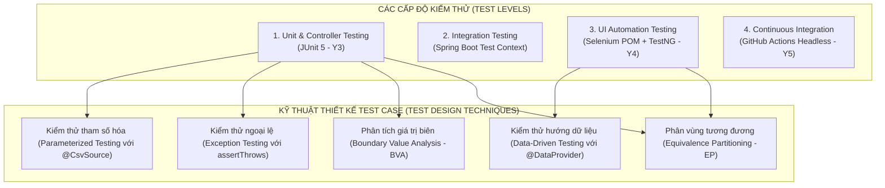
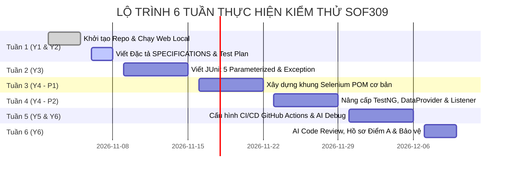

# KẾ HOẠCH KIỂM THỬ TỔNG THỂ (MASTER TEST PLAN)
> **DỰ ÁN: CONBOVUIVE GEAR - WEBSITE THƯƠNG MẠI ĐIỆN TỬ GAMING GEAR & PHẦN CỨNG PC**  
> **Môn học:** SOF309 - Kiểm thử nâng cao cùng AI (Advanced Software Testing with AI)  
> **Vai trò thực hiện:** QA Lead / Test Architect  
> **Sinh viên thực hiện:** Nguyễn Hoàng | **MSSV:** TS02492 | **Lớp:** SD21304  
> **Giảng viên hướng dẫn:** ThS. Trần Quang Bình (binhtq7 - Thầy Mời Giáo)  
> **Phiên bản:** v1.0.0 (Milestone Tuần 1 - Nghiệm thu Y2 & Y6)  

---

## 1. GIỚI THIỆU & MỤC TIÊU KIỂM THỬ (INTRODUCTION & OBJECTIVES)

### 1.1. Giới thiệu tổng quan
Tài liệu Kế hoạch kiểm thử này xác định toàn bộ chiến lược, kỹ thuật, phạm vi, môi trường, tiêu chí chất lượng và lịch trình thực thi kiểm thử tự động cho dự án **Conbovuive Gear**. Hệ thống được thiết kế theo kiến trúc Spring Boot Web (Java 17) kết hợp Frontend Single Page Application (SPA), phục vụ trực tiếp cho lộ trình 6 tuần của môn học SOF309 tại FPT Polytechnic.

### 1.2. Mục tiêu kiểm thử cốt lõi
1. **Kiểm thử đơn vị tầng nghiệp vụ (Unit & Service Testing - Milestone Y3):**
   * Đạt tỷ lệ bao phủ kiểm thử cao cho các Controller (`AuthController`, `ProductController`, `OrderController`, `VoucherController`, `CategoryController`, `StatsController`).
   * Áp dụng triệt để kỹ thuật **Phân vùng tương đương (EP)** và **Phân tích giá trị biên (BVA)** vào các bài kiểm tra tham số hóa `@ParameterizedTest` kết hợp `@CsvSource`.
   * Kiểm thử ngoại lệ nghiệp vụ bắt buộc (`assertThrows`) cho các hành vi vi phạm ràng buộc dữ liệu (trùng lặp tài khoản, giá âm, tồn kho âm, dữ liệu rỗng).
2. **Kiểm thử tự động giao diện người dùng (UI Automation Testing - Milestone Y4):**
   * Thiết kế khung kiểm thử chuẩn theo mô hình **Page Object Model (POM)** để phân tách tường minh giữa bộ định danh (Locators) và kịch bản kiểm thử (Test Scenarios).
   * Sử dụng cơ chế đồng bộ hóa `WebDriverWait` (Explicit Wait), tuyệt đối loại bỏ `Thread.sleep()`.
   * Nâng cấp lên TestNG Framework: phân nhóm kiểm thử (`groups = "smoke"`, `"regression"`), chạy kiểm thử theo hướng dữ liệu (`@DataProvider`), tự động chụp ảnh màn hình khi có lỗi (`ITestListener` $\rightarrow$ thư mục `screenshots/`).
3. **Tự động hóa tích hợp liên tục (CI/CD Pipeline - Milestone Y5):**
   * Tự động kích hoạt toàn bộ suite kiểm thử trên môi trường ảo hóa GitHub Actions mỗi khi có commit hoặc Pull Request.
   * Chạy kiểm thử trình duyệt Chrome ở chế độ không giao diện (`--headless=new`) trên hệ điều hành Ubuntu.
   * Tự động đóng gói và xuất báo cáo Surefire Report cùng ảnh chụp lỗi lên tab **Artifacts**.
4. **Nhật ký minh chứng tương tác AI (AI Testing Logs - Milestone Y6 Điểm A):**
   * Lưu trữ đầy đủ 6 tệp nhật ký tương tác AI trong thư mục `docs/ai-logs/` chứng minh năng lực ứng dụng AI RAG trong việc thiết kế test case, hỗ trợ lập trình script, debug lỗi và tối ưu mã nguồn.

---

## 2. PHẠM VI KIỂM THỬ (TEST SCOPE)

### 2.1. Trong phạm vi kiểm thử (In-Scope)
* **Phân hệ Xác thực & Người dùng (Authentication Module):**
  * Luồng đăng nhập tại trang tĩnh độc lập `/login` và Modal Auth trên Trang chủ.
  * Luồng đăng ký tài khoản mới với các ràng buộc về độ dài username, định dạng email, độ dài password và tính duy nhất của tài khoản.
  * Tra cứu thông tin hồ sơ người dùng (`GET /api/auth/profile`).
* **Phân hệ Quản lý & Tra cứu Sản phẩm (Product Catalog & CRUD Module):**
  * Tải danh sách 16 sản phẩm mặc định.
  * Lọc sản phẩm theo danh mục (`mouse`, `keyboard`, `monitor`, `gpu`, `audio`), theo thương hiệu, theo khoảng giá (`minPrice`, `maxPrice`).
  * Tìm kiếm sản phẩm theo từ khóa tương đối (`search`).
  * Sắp xếp sản phẩm theo giá tăng dần, giá giảm dần, điểm đánh giá và lượt reviews.
  * Xem thông số chi tiết sản phẩm qua Modal (`GET /api/products/{id}`).
  * Thao tác Quản trị CRUD: Thêm mới sản phẩm, cập nhật thông tin sản phẩm, xóa sản phẩm khỏi kho.
* **Phân hệ Động cơ Khuyến mãi & Mã giảm giá (Voucher Engine):**
  * Xác thực tính hợp lệ của 4 mã ưu đãi: `GEARVIP10` (Giảm 10%), `FREESHIP` (Miễn phí ship), `CHAOBAN` (Giảm 100.000₫), `CONBOVUIVE` (Giảm 15%).
  * Xử lý mã voucher không hợp lệ, mã hết hạn hoặc để trống mã.
* **Phân hệ Giỏ hàng & Xử lý Đơn hàng (Cart & Order Processing):**
  * Thêm sản phẩm vào giỏ hàng, cập nhật số lượng, tính toán tạm tính và phí giao hàng.
  * Áp dụng voucher giảm giá vào giỏ hàng.
  * Luồng thanh toán và tiếp nhận đơn hàng (`POST /api/orders`): Kiểm tra thông tin bắt buộc của khách hàng, tự động sinh mã `CBV-xxxxxx` và gán trạng thái `"Chờ xác nhận"`.
* **Phân hệ Thống kê Hệ thống (System Statistics):**
  * API `GET /api/stats`: Đếm tổng số sản phẩm, danh mục, đơn hàng và sản phẩm hot.

### 2.2. Ngoài phạm vi kiểm thử (Out-of-Scope)
* Kiểm thử bảo mật chuyên sâu (Security Penetration Testing, SQL Injection, XSS nâng cao do hệ thống dùng In-memory Collections).
* Kiểm thử tải trọng cực lớn (Stress Testing trên 100.000 người dùng đồng thời).
* Tích hợp cổng thanh toán trực tuyến thực tế của ngân hàng (VNPay, MoMo) - Hệ thống hiện xử lý phương thức Ship COD / Chuyển khoản nội bộ.

---

## 3. CHIẾN LƯỢC & KỸ THUẬT KIỂM THỬ (TEST STRATEGY & METHODOLOGY)

### 3.1. Kỹ thuật Phân vùng tương đương (Equivalence Partitioning - EP)
Chia miền dữ liệu đầu vào thành các lớp tương đương hợp lệ (Valid Partition) và không hợp lệ (Invalid Partition). Mỗi phân vùng chỉ cần chọn 1 giá trị đại diện để thiết kế test case, tối ưu hóa số lượng kịch bản nhưng vẫn đảm bảo tính bao phủ:
* **Username:** Phân vùng hợp lệ [3-20 ký tự, chưa có trong hệ thống], Phân vùng không hợp lệ [< 3 ký tự, > 20 ký tự, rỗng, đã tồn tại].
* **Password:** Phân vùng hợp lệ [$\ge 3$ ký tự], Phân vùng không hợp lệ [< 3 ký tự, rỗng].
* **Giá sản phẩm:** Phân vùng hợp lệ [$price > 0$], Phân vùng không hợp lệ [$price \le 0$].
* **Tồn kho sản phẩm:** Phân vùng hợp lệ [$stockCount \ge 0$], Phân vùng không hợp lệ [$stockCount < 0$].
* **Mã giảm giá:** Phân vùng hợp lệ [`GEARVIP10`, `FREESHIP`, `CHAOBAN`, `CONBOVUIVE`], Phân vùng không hợp lệ [mã sai, rỗng].

### 3.2. Kỹ thuật Phân tích giá trị biên (Boundary Value Analysis - BVA)
Tập trung kiểm thử tại các điểm biên danh định (Boundary), cận dưới biên (Just below) và cận trên biên (Just above), nơi có xác suất phát sinh lỗi logic cao nhất:
* **Biên độ dài Username (3 đến 20 ký tự):**
  * Cận dưới: 2 ký tự (Không hợp lệ $\rightarrow$ Ném `IllegalArgumentException`)
  * Biên dưới: 3 ký tự (Hợp lệ $\rightarrow$ Pass)
  * Biên trên: 20 ký tự (Hợp lệ $\rightarrow$ Pass)
  * Cận trên: 21 ký tự (Không hợp lệ $\rightarrow$ Ném `IllegalArgumentException`)
* **Biên độ dài Password ($\ge 3$ ký tự):**
  * 2 ký tự (Không hợp lệ) | 3 ký tự (Hợp lệ)
* **Biên giá sản phẩm ($price > 0$):**
  * -1₫ (Không hợp lệ) | 0₫ (Không hợp lệ) | 1₫ (Hợp lệ)
* **Biên tồn kho ($stockCount \ge 0$):**
  * -1 (Không hợp lệ) | 0 (Hợp lệ - Trạng thái hết hàng) | 1 (Hợp lệ)

### 3.3. Kỹ thuật Kiểm thử Ngoại lệ (Exception Testing)
Kiểm tra tính bền vững của mã nguồn bằng cách chủ động truyền dữ liệu vi phạm nghiệp vụ và dùng `assertThrows()` để thẩm định loại ngoại lệ (`IllegalArgumentException`, `IllegalStateException`, `NoSuchElementException`) cùng nội dung thông báo lỗi trả về.

### 3.4. Mô hình kiểm thử giao diện Page Object Model (POM)
Tách biệt toàn bộ định danh phần tử giao diện (Locators) vào các lớp Page Object:
* `LoginPage.java`: Quản lý các Locator (`txtUsername`, `txtPassword`, `btnLogin`, `lblErrorMessage`) và các hành động (`enterUsername`, `enterPassword`, `clickLogin`).
* `ProductPage.java`: Quản lý lưới sản phẩm, bộ lọc danh mục và thanh tìm kiếm.
* `CartPage.java` & `CheckoutPage.java`: Quản lý giỏ hàng, áp mã ưu đãi và form đặt hàng.
* Kịch bản test độc lập (`LoginTest.java`, `CartTest.java`) chỉ tương tác thông qua các phương thức nghiệp vụ của Page Object.

---

## 4. MÔI TRƯỜNG KIỂM THỬ (TEST ENVIRONMENT & TOOLING)

| Thành phần | Đặc tả cấu hình chi tiết |
| :--- | :--- |
| **Phần cứng kiểm thử** | CPU Intel Core i5/i7, RAM 8GB trở lên, Ổ cứng khả dụng $\ge 2GB$ |
| **Hệ điều hành Local** | Windows 11 64-bit |
| **Hệ điều hành CI/CD** | Linux Ubuntu Latest (GitHub Actions Runner Virtual Machine) |
| **Java Development Kit** | OpenJDK 17 (LTS) 64-bit |
| **Trình duyệt kiểm thử** | Google Chrome (Phiên bản mới nhất) |
| **Trình điều khiển (Driver)**| ChromeDriver (Quản lý tự động qua Selenium 4 WebDriverManager) |
| **Công cụ Build & Test** | Apache Maven 3.9+, Maven Surefire Plugin 3.2.5 |
| **Cổng dịch vụ kiểm thử**| `http://localhost:8080` |
| **Thư viện kiểm thử** | JUnit Jupiter 5.10.2, Selenium Java 4.20.0, TestNG 7.9.0 |

---

## 5. TIÊU CHÍ CHẤT LƯỢNG & NGHIỆM THU (PASS/FAIL CRITERIA)

### 5.1. Tiêu chí cho từng Test Case
* **Pass:** Hành vi thực tế của hệ thống (Status code, Response JSON, thông điệp lỗi, điều hướng UI) trùng khớp 100% với Kết quả mong đợi (Expected Result).
* **Fail:** Có bất kỳ sự sai lệch nào về dữ liệu, lỗi `AssertionError`, hoặc phát sinh Exception không mong muốn (`NullPointerException`, HTTP 500).

### 5.2. Tiêu chí nghiệm thu toàn dự án (Suspension & Exit Criteria)
* **100%** các test script JUnit 5 cho Controller & Service thực thi thành công (`mvn test` Pass 100%).
* **100%** các kịch bản Selenium UI Test chạy mượt mà trên Chrome Local và chế độ Headless trên CI.
* Pipeline GitHub Actions hiển thị dấu tích **Xanh lá cây (Pass)** tại tab Actions.
* Báo cáo kiểm thử Surefire Report và thư mục ảnh chụp lỗi `screenshots/` được upload tự động lên tab Artifacts.
* Đầy đủ 6 tệp nhật ký tương tác AI trong thư mục `docs/ai-logs/` theo đúng cấu trúc chuẩn.

---

## 6. PHÂN BỔ NGUỒN LỰC & LỊCH TRÌNH 6 TUẦN (TIMELINE ROADMAP)

* **Tuần 1 (02/11 - 08/11) [Xong Y1 & Y2]:** Khởi tạo Repo chuẩn, tích hợp Web cá nhân vào `src/main`, hoàn thiện `SPECIFICATIONS.md`, `TEST_PLAN.md`, `TEST_CASES.md`.
* **Tuần 2 (09/11 - 15/11) [Xong Y3]:** Viết Unit Test Controller với JUnit 5 (`@ParameterizedTest`, `@CsvSource`, `assertThrows`), nộp file `01_test_design_ai.md`.
* **Tuần 3 (16/11 - 22/11) [Y4 - Phần 1]:** Thiết kế mô hình Page Object Model, tạo các lớp `LoginPage.java`, `ProductPage.java`, dùng `WebDriverWait` xử lý bất đồng bộ.
* **Tuần 4 (23/11 - 29/11) [Y4 - Phần 2]:** Nâng cấp TestNG: gán nhãn `groups = "smoke"`, `@DataProvider` nạp danh sách tài khoản, `ITestListener` chụp ảnh lỗi vào `screenshots/`.
* **Tuần 5 (30/11 - 06/12) [Xong Y5]:** Cấu hình file workflow `.github/workflows/test.yml`, chạy Chrome Headless trên Ubuntu, xuất Artifacts báo Xanh.
* **Tuần 6 (07/12 - 10/12) [Xong Y6 - Điểm A]:** AI Code Review, hoàn thiện 6 file trong `docs/ai-logs/`, chuẩn bị Slide thuyết trình bảo vệ trước Giảng viên.

---

## 7. QUẢN LÝ RỦI RO KIỂM THỬ (RISK MANAGEMENT)

| Rủi ro tiềm ẩn (Risk) | Mức độ | Biện pháp giảm thiểu & Ứng phó (Mitigation Strategy) |
| :--- | :---: | :--- |
| **Selenium UI test bị chập chờn (Flaky Tests)** do mạng chậm hoặc DOM chưa kịp render | Cao | Tuyệt đối không dùng `Thread.sleep()`. Áp dụng đồng bộ `WebDriverWait(driver, Duration.ofSeconds(10))` kết hợp `ExpectedConditions.visibilityOfElementLocated()`. |
| **Trình duyệt Chrome trên GitHub Actions không có màn hình GUI** | Cao | Cấu hình cờ `--headless=new`, `--no-sandbox`, `--disable-dev-shm-usage` trong file cấu hình test hoặc biến môi trường `CI=true`. |
| **Dữ liệu kiểm thử bị thay đổi giữa các ca test do dùng In-memory Collections** | Trung bình | Khởi tạo lại dữ liệu mới trong phương thức `@BeforeEach` của mỗi test class (`new AuthService()`, `new ProductService()`). |
| **Tràn bộ nhớ đĩa ổ cứng cục bộ (Disk Full)** | Thấp | Định kỳ dọn dẹp các tệp cài đặt tạm thời trong `%TEMP%` và thư mục `target/`. |
